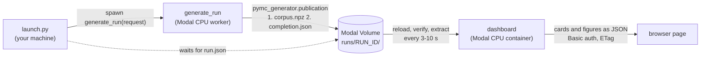

# PyMC Generator live dashboard

> **Experimental, internal tool.** `live_dashboard/` is a PyMC Labs repository tool, not
> part of the installed `pymc-generator` package, and its publication protocol is an
> interim single-writer design (see
> [Publication protocol](#publication-protocol-pymc-generator-live-publication-12)).

Follow a generation run while it happens. A generation worker publishes each completed
task (a corpus payload plus a versioned JSON completion record) into a store; a separate
web app polls the store, verifies and extracts every newly published output once, and
redraws its cards and figures in the browser. Generation never reruns for the UI.

On Modal, both live in the **`pfn` environment**: `generate_run` runs on a CPU container
and the dashboard on a separate CPU container with a stable URL behind HTTP Basic
authentication. The same code runs locally against a folder.

> **Decision (October 2026): workers run on CPU, not on an A100.** Generation is CPU
> work: PyTensor 3.2 has no native CUDA backend, and the generator compiles its graphs
> in `FAST_COMPILE` mode to Python/NumPy thunks. Measured on Modal, CPU-only workers
> generate as fast as A100 workers for about 1/20 of the cost; see
> [Hardware decision: CPU workers](#hardware-decision-cpu-workers).

## Reusable-family streaming (opt-in)

For compilation reuse, bounded per-worker save queues and incremental ten-world
publications, use [`scripts/modal_streaming.py`](../scripts/modal_streaming.py).
See [launch, resume, resource limits and scientific differences](STREAMING.md).
By default this is a separate compositional prior that allows signed controls; with
`--design structural-splits` it compiles the 50 member configurations of the
[structural-split design](#structural-splits-structural-splits) instead (one model per split ×
regime, controls never below zero). It does not change existing demo presets or
automatically launch a large corpus.

## How the legacy demo works



1. **A request names a run.** A request is a label, a preset, a number of worlds, the
   worlds per task and a seed. The run id is `<label>-<sha256(request)[:12]>`, so the
   same request always names the same run (that is how `--resume` finds it) and a new
   label starts a new run. The run is split into `worlds ÷ worlds_per_task` tasks, and
   task `i` generates with seed `seed + i` (a
   [structural-split design](#structural-splits-structural-splits) seeds each split on
   its own).
2. **Launch** (`launch.py`, an ephemeral Modal app run from your machine). It checks the
   request and the demo bounds, refuses an existing run unless `--resume`, spawns the
   deployed `generate_run`, prints the run id and its dashboard link, and for a new run
   waits until the run's manifest appears in the Volume.
3. **Generate and publish** (`generate_run` calling `run_generation` in
   `generation.py`, one container at a time: the run's single driver). It writes the run
   manifest (effective configuration, digest of the generating source, package
   versions, git revision). Then, task by task:
   - `DataGenerator.generate(n_tasks=worlds_per_task, seed=seed + i,
     defer_cell_split=True)` generates the task's worlds (with the preset `cycle[i mod n]`
     of a [preset mix](#presets-and-mixes)); their train/validation membership stays
     unassigned (`is_val=2`) until a training snapshot assigns whole cells. A
     structural-split design draws a task again, with a new seed, when one of its
     controls goes below zero or the library cannot fill it;
   - `pymc_generator.publication` (#67) publishes them: it validates the corpus, saves
     `corpus.npz` in the task attempt's own directory, commits the Volume, then writes the
     task's version-1 `completion.json` (accounting, provenance, world ids) and commits
     again.

   An attempt record tracks progress. The attempt stops starting tasks before Modal's
   kill time, so `--resume` can continue it.
4. **Store** (Modal Volume `pymc-generator-live-dashboard`). Plain files under
   `runs/<run_id>/`; nothing is ever overwritten. A retry writes under its own attempt
   id. The layout is under [Publication protocol](#publication-protocol-pymc-generator-live-publication-12).
5. **Read** (the `dashboard` container: `collection.py`, `extract.py`). A poller thread
   reloads the read-only Volume, every 3 s while a run is generating and every 10 s
   otherwise. On each poll it:
   - discovers each run's task completions through `pymc_generator.publication` (and
     reads the task records of runs published before it);
   - checks each new payload's size and SHA-256;
   - extracts each new payload's metrics once: composition shares, channel and
     control impact through the library's `outcome_distributions`, the adstock and
     saturation families (and their pairs) of each world's active channels, and how
     many of its channels and controls have an effect (an arrow to the target in `g`).

   The result is an immutable snapshot; requests never touch the Volume.
6. **Show** (`figures.py`, `web.py`, `static/`). The page polls the JSON API with an
   ETag. The server answers 304 until the snapshot changes; then the page redraws the
   cards and Plotly figures. Every path requires Basic authentication.

Locally the same flow runs without Modal: `generate` writes into a folder and `serve`
reads it.

## What the page shows

| Element | Definition |
|---|---|
| Card: worlds generated | Consumable worlds (published, verified, extracted) of the run's target. |
| Card: generation speed | Consumable worlds per minute of active generation time (the union of task start–finish intervals, so gaps between attempts do not count). |
| Card: estimated generation cost | The run's attempts summed: each attempt's recorded time (from its start to its latest update, which the worker writes before every task) at the hourly list price its worker recorded ($0.126/h for 2 cores and 4 GiB). A lower bound of Modal's bill: container start-up, scale-down and the time after an attempt's last update (the task in progress, or a killed container) are not counted; "≥" marks a total that also misses attempts without a price. Runs made before workers recorded a price, and local runs, show —. |
| Speed over time | Per-task rate (worlds ÷ generation time) and the cumulative average. |
| Worlds over time | Cumulative consumable worlds at each publication, with the target. |
| Channel impact | Two distributions: the direct contribution share of each channel with an effect (an active channel with a direct edge to the target) in its world's outcome (pooled), and each world's total channel share (direct + indirect). |
| Control impact | The same for controls: the direct contribution share of each control with an effect (pooled), and each world's total control share (net, can be negative). |
| Baseline | Each world's baseline share. Channel impact, control impact and baseline share one 0–100 % axis (widened only to fit a value outside it), so the three compare at a glance. |
| Composition triangle | Each world's channel / control / baseline shares of its total outcome, at its exact barycentric position (corner = 100 %). Semi-transparent dots, so overlap shows density; worlds with a negative part sit outside and are drawn as ×. |
| Worlds per saturation form | Consumable worlds per saturation family their active channels use, with all six library families on the x axis (linear, Hill, logistic, Michaelis-Menten, tanh, root); a world whose channels mix families counts once in each. Read from each payload's `sat_family`, which the library records only for configurations with mechanism priors; worlds without it are noted, not counted. |
| Worlds per adstock form | The same for the adstock (carryover) family: none, geometric, Weibull (`carryover_family`, recorded in every payload). |
| Worlds per structural split | Heatmap of consumable worlds per (saturation, adstock) family pair of their active channels: every library saturation family (rows) × every adstock family (columns), so absent splits stay blank and the note counts the splits present; a world whose channels use several pairs counts once in each (noted). Read from `sat_family` and `carryover_family`; as in the saturation panel, worlds without `sat_family` are noted, not counted. |
| Worlds per channel columns × control columns | Heatmap of consumable worlds per combination of channel-column and control-column counts (a world's columns are its active channels and controls, with or without an effect). Every combination the layout allows has a cell (1 to the slot count on each axis, 0 too when some world has no column); absent combinations stay blank, and the note counts how many are present. |
| Worlds per number of columns and of inputs with an effect | Consumable worlds per number of channel columns, of channels with an effect (a direct edge to the target), of control columns and of controls with an effect, side by side; the column bars are the matrix's two margins. |
| Channels and controls per share of their weeks at zero | Every active channel and control of a consumable world is one series (`treatment_raw`, `covariates`); its share of weeks at exactly 0 falls in "none" or a tenth of the series (upper bound included: 3 of 30 weeks is "≤ 10 %"). Bars are percentages of each role's series, side by side; the note counts the series with any week at zero. |
| Where the weeks at zero fall | The weeks of each series split into a first, middle and last third (at `weeks // 3` and `2 × weeks // 3`: 69, 69 and 70 of 208). Each role's bars are the share of its weeks at zero in each third, so an even spread puts a third in each (dashed line); the hover adds the weeks at zero and their share of that third's weeks. |
| Status line | Run state, recorded tasks, zero-world tasks and shortfalls, rejected candidates, draw failures, unavailable/conflicting/invalid outputs, duplicates, and the newest attempt (with its GPU, for the early runs that had one). |

Shares use the trajectory-showcase notebook's definitions (`realized_shares`):
channel = Σ treatment contributions + Σ indirect effects, control = Σ covariate
contributions (net, can be negative), baseline = Σ intrinsic baseline + Σ latent
contributions + Σ observation noise, each divided by Σ outcome. Channel and control
impact are the library's `outcome_distributions(...)` `unit_share` of
`"treatment_contribution"` and `"covariate_contribution"`, kept for the inputs with an
effect (a `C→Y` or `Z→Y` edge in the payload's graph `g`): a column without one
contributes nothing directly. Slots are activated as a prefix (channel slot k is active
only in worlds with at least k channels; controls likewise), so impact is shown pooled,
never per slot.

Only published worlds enter the distributions. Pending, zero-world, unavailable,
conflicting and invalid tasks appear in the status line instead.

Large runs. A violin draws at most 2,000 of its values, at evenly spaced ranks (the
smallest and largest included), and the composition triangle at most 4,000 worlds per
marker type, evenly spaced in run order; the panel note says how many were drawn of how
many, and counts, legends and axes still cover every value. (A 200,000-world run has
about 1.3 million channel and control units: drawing them all made a 105 MB body per
poll and 15 s of work per refresh, measured on Modal.) A refresh spends at most 10 s
reading and extracting payloads it has not read yet: a cold container over a large store
shows the rest as `loading` (status line, and the empty panels say so), counts only the
worlds it has read, and reads the rest in the following refreshes, every 3 s.

## Local use

`live_dashboard` is a repository tool (it is not part of the installed `pymc-generator`
package): run its commands from the repository root.

```bash
uv sync --locked --extra dev --extra dashboard
# Credentials: a username and a PBKDF2 hash, written to a 0600 JSON file.
uv run --no-sync python -m live_dashboard hash-password --username demo \
    --output ~/.config/pymc-generator-dashboard/auth.json
# Terminal 1: the dashboard on http://127.0.0.1:8000
uv run --no-sync python -m live_dashboard serve --data-dir /tmp/live-runs \
    --credentials ~/.config/pymc-generator-dashboard/auth.json
# Terminal 2: generate 20 worlds as 10 published tasks of 2 worlds
uv run --no-sync python -m live_dashboard generate --data-dir /tmp/live-runs \
    --label local-demo --worlds 20 --worlds-per-task 2
```

Presets and mixes: see [Presets and mixes](#presets-and-mixes). `generate --max-seconds`
(default 3600) is the attempt's time limit; rerun the same command to resume a stopped
run (for a structural-split design, add `--seed <the printed seed>`: without it the
command seeds a new run from the current time).

## Modal deployment (environment `pfn`)

Run from the repository root with the Modal CLI (`modal` ≥ 1.5). Both entry points
refuse to run unless the CLI environment is `pfn`.

```bash
# 1. Credentials into a Modal Secret (JSON keeps the hash free of shell expansion).
uv run --no-sync python -m live_dashboard hash-password --username demo --output auth.json
modal secret create -e pfn pymc-generator-dashboard-auth --from-json auth.json
rm auth.json   # keep the password elsewhere; the secret holds only its hash
# 2. Deploy the worker and the dashboard (prints the stable dashboard URL).
modal deploy -e pfn live_dashboard/modal_app.py
# 3. Start a run: prints the run id and its dashboard link; for a new run it then waits
#    up to 10 minutes for the worker to publish it (or exits with the reason it refused
#    or failed). --resume continues an existing run without waiting; --wait blocks
#    until the worker returns its summary.
modal run -e pfn live_dashboard/launch.py --label demo --worlds 20 --worlds-per-task 2
```

Resources: app `pymc-generator-live-dashboard`, Volume `pymc-generator-live-dashboard`
(v1), Secret `pymc-generator-dashboard-auth`, web label `pymc-generator-dashboard`, and
the ephemeral launcher app `pymc-generator-live-dashboard-launch`, all in `pfn`. The
dashboard mounts the Volume read-only and calls `reload()` on it (verified on the first
deployment); if a future Modal release refused that, mounting it read-write keeps the
same behaviour because the dashboard never writes. Rotate credentials with
`modal secret create --force ...` and redeploy.

Limits: `generate_run` uses 2 CPU cores and 4 GiB (no GPU), one container at a time, a
3-hour (10,800 s) timeout and one retry. So one launch costs at most about two attempts
of 3 hours, ≈ $0.76 at Modal's October 2026 list prices; a 20-world run costs about
$0.003 and the 1,000-world structural-split run about $0.2. A run is capped at 1,000
worlds and 20 worlds per task. Requests the worker can never satisfy (unknown preset,
too large, a different generator than the stored run) are refused without a retry; the
refusal is recorded as a failed attempt when the run exists. Each attempt records its
kill time as `deadline_at` and stops starting a draw (a task's first, or a design's
redraw) unless max(90 s, twice its longest draw) is left; a resumed run continues with
the unpublished tasks. The dashboard uses one CPU core and 4 GiB, one container, and scales
to zero after 10 idle minutes; `DASHBOARD_KEEP_WARM=1 modal deploy ...` keeps it running
(about $0.08/h) while a large run is supervised, and a deploy without it scales to zero
again. A cold container rereads the whole store (about 30 ms per file on the Volume:
5 minutes for today's 1,300 tasks); it starts serving after at most 60 s, answers "waiting
for the first store refresh" until that first read ends, then fills in as above. Polling
is every 3 s while a run is generating, while payloads are loading (or while the store
cannot be read) and every 10 s otherwise (`DASHBOARD_POLL_SECONDS`), plus up to one
browser poll; this is a refresh cadence, not a latency guarantee.

## Running future generations

### Choose the request

`launch.py` (Modal) and `python -m live_dashboard generate` (local) take the same
request options:

| Option | Default | Notes |
|---|---|---|
| `--label` | required | Part of the run id; use a new label for a fresh run. |
| `--preset` | `showcase-variety` | A preset from `PRESETS` or a mix from `MIXES` in `generation.py` (see below). |
| `--worlds` | 20 | Target worlds. Must be a multiple of `--worlds-per-task` (and, for a design, of its splits × worlds per task), and at most 1,000 (`DEMO_MAX_WORLDS`). |
| `--worlds-per-task` | 2 | Worlds per published task, at most 20 (`DEMO_MAX_WORLDS_PER_TASK`). The page updates once per task, so smaller tasks show progress more often. |
| `--seed` | 29; a design: the launch time | Base seed; task `i` uses `seed + i`. A structural-split design defaults to the UTC launch time as `YYYYMMDDHHMMSS` and derives each split's seed from it; the launcher prints the seed, which `--resume` needs again. |

### Presets and mixes

| Name | Kind | Generates |
|---|---|---|
| `showcase-variety` | preset | The trajectory-showcase notebook's ranges: 10 channels, 10 controls, geometric adstock, Michaelis-Menten saturation, active counts drawn independently per world (the notebook's stratified design needs one call per multiple of 10 worlds). |
| `geometric-mm` | preset | [Two-style variety](#two-style-variety-geometric-mm-geometric-logistic) with Michaelis-Menten saturation. |
| `geometric-logistic` | preset | Two-style variety with logistic saturation. |
| `geometric-mm-logistic` | mix | `geometric-mm` and `geometric-logistic`, alternating by task. |
| `structural-splits` | design | [Structural splits](#structural-splits-structural-splits): every saturation family but root × adstock none or geometric, five texture regimes, 208 weeks, columns with and without an effect, positive controls. |
| `small` | preset | A tiny configuration for tests and smoke runs. |

A **mix** is one run whose tasks cycle through its member presets: task `i` uses member
`i mod n` (and, as always, seed `seed + i`). The members therefore grow together on the
page, finish with equal world counts when the task count is a multiple of `n`, and the
run's payloads are the concatenation of their generations: the page shows the combined
dataset, and the form panels show each member's worlds as they arrive. The manifest
records the cycle and every member's configuration (`generator.config = {"cycle": [...],
"presets": {...}}`), so changing any member refuses a resume. To add one, map a new name
to a tuple of preset names in `MIXES`.

### Launch, follow and resume

```bash
modal run -e pfn live_dashboard/launch.py --label <label> --worlds 100 --worlds-per-task 5
```

Open the printed link, or pick the run in the page's run menu.

- **Timing.** On Modal a 104-week world takes about 4–6.5 s of wall-clock time
  (generation plus about 2.7 s per task of Volume commits, which the speed card leaves
  out), so 20 worlds take 1.5–2.5 minutes; a 208-week structural-split world about 5 s
  of generation. The two-style presets measured 5–15 % slower than `showcase-variety`
  per world (ten tasks of each on one laptop).
- **Attempt length.** One attempt lasts at most 3 hours, roughly 1,500–2,500 worlds. A
  larger run stops cleanly; finish it by rerunning the same command with `--resume`.
- **Changed generator.** Resuming with a different configuration, code or environment
  is refused, so start a run with changed code under a new label.

| Run state | Meaning | Next step |
|---|---|---|
| `waiting` | The manifest exists but no attempt has recorded progress yet. | Wait. |
| `running` | The newest attempt is generating. | Wait. |
| `complete` | Every task has a final record. Zero-world tasks and output problems are listed in the status line. | Done. |
| `stopped` | The newest attempt ended (for example, near its time limit) with tasks left. | `--resume` |
| `failed` | The newest attempt raised. Its error is in `runs/<run_id>/attempts/`. | Fix the cause, then `--resume`. |
| `lost` | The newest attempt passed its kill time without finishing (the container died). | `--resume` |

### Get the data out

The trailing `/` downloads the run folder:

```bash
mkdir -p live-runs/runs
modal volume get -e pfn pymc-generator-live-dashboard runs/<run_id>/ live-runs/runs
```

Then, from the repository root, read it through `pymc_generator.publication` (the
consumer interface of #67):

```python
from pymc_generator.publication import FilePublicationStore

store = FilePublicationStore("live-runs")
outputs = store.validated_outputs("<run_id>")  # verified completions, retries deduplicated
corpora = [store.read_output(item["reference"])[1] for item in outputs]
corpora = [corpus for corpus in corpora if corpus is not None]  # zero-world tasks have none
# A frozen training snapshot assigns train/validation membership by whole cells.
snapshot = store.freeze_snapshot("<run_id>", "training", validation_fraction=0.2, split_seed=17)
membership = store.read_training_split(snapshot)  # world id -> "train" or "validation"
```

Reading through it, rather than globbing `*.npz`, skips unfinished attempts (a payload
without a completion) and refuses payloads that fail their digest; `validated_outputs`
fails closed if any completion of the run is unresolved. A mix run's corpora already hold
every member's worlds, so `corpora` is the concatenated dataset; a world's member is its
task index modulo the number of members, and its corpus's `carryover_family` and
`sat_family` record its functional form. The share figures' metrics come from the
dashboard's reader: `Collector(DirectoryStore(Path("live-runs")))` then `refresh()`;
`snapshot.run_index["<run_id>"]` holds `worlds`, `impacts` and `control_impacts`. That
reader also reads runs published before #67 (task records next to `payloads/`). To
browse downloaded runs locally, run `serve --data-dir live-runs`.

### Two-style variety (`geometric-mm`, `geometric-logistic`)

Two configurations that differ only in the saturation curve, built to be generated
together (`geometric-mm-logistic`) as one dataset:

- **Inputs:** 10 channels and 10 controls; each world draws 1–10 active channels and
  1–10 active controls independently, so any of the 100 combinations can occur.
- **Graph:** every active channel and control points only to the target: no channel →
  channel, control → channel, control → control or latent arrows. (The library needs one
  latent node; it has no arrows and contributes exactly 0.)
- **Response:** geometric adstock (decay 0.05–0.9) with Michaelis-Menten saturation
  (half-saturation 0.1–10 × the channel's usual level, log-uniform) or logistic
  saturation (λ 0.3–5, uniform; the library has no log-uniform option for λ).
- **Positive effects:** channel contributions are non-negative by construction; controls
  have positive coefficients and stay positive because their level (4–7) sits well above
  their swings; the baseline walk is floored at 0; the library rejects any world whose
  target goes below 0.
- **Trajectories** (channels and controls alike): on/off blocks (half of the inputs),
  late starts and early stops (15 % each), trends, yearly seasonality, a level jump,
  weekly jitter and pulses, on random walks whose smoothness runs from raw to a 26-week
  moving average.
- **Baseline:** a random walk (level 2–16, spread ~ HalfNormal(0.8)) with its own
  smoothness, plus weekly noise (in target units: `outcome_std_mode="absolute"`).
- **Shares:** each channel and each control contributes 0.1–3.9 target units at its
  usual level: the mean of 1–3, so neither side dominates and the channel / control /
  baseline split stays even, but effects up to 39× apart within a world. The baseline
  level is 2–16. The three shares follow the active counts and the baseline level.

Measured on the Modal run `two-styles-even-1ca0e8c013fc` (`geometric-mm-logistic`, 240
worlds, 2 per task, seed 1000), from its published payloads read on Modal through the
dashboard's verified reader. "Skewed" is the previous run with channels 0.1–10 and
controls 1–3 (`two-styles-radical-5860b66184a8`); "1–3" is `two-styles-64091b9843a5`.

| Property | Result |
|---|---|
| Worlds per style | 120 Michaelis-Menten, 120 logistic |
| (channels, controls) combinations | 91 of 100; every count 1–10 on both axes |
| Channel / control / baseline share (min–median–max) | 1.6–33–76 % / 1.0–32–79 % / 7.1–35–82 % (skewed: medians 52 / 21 / 26 %) |
| All three shares within 5–90 % | 91.7 % of worlds; none below 1 % or above 90 % |
| Each active channel's direct share (median / 95th pct / max) | 4.8 / 14.1 / 43 % (skewed: 7.4 / 21.5 / 61 %; 1–3: 5.3 / 12 / 32 %) |
| Active channels above 10 % / 20 % of the outcome | 15.5 / 1.2 % (skewed: 36 / 6.7 %; 1–3: 10 / 0.3 %) |
| Largest channel per world (median / 90th pct) | 11.2 / 18 % (skewed: 17.6 / 27 %; 1–3: 9.5 / 14.5 %) |
| Each active control's direct share (median / 95th pct / max) | 4.4 / 15.5 / 39 % (skewed: 3.3 / 9.6 / 32.5 %; 1–3: 5.0 / 12.9 / 34 %) |
| Channels: no zeros / under half zeros / half or more | 37 / 37 / 27 % |
| Channels: trend up / down / flat | 41 / 39 / 20 % |
| Channels: very smooth / medium / rough | 30 / 23 / 47 % |
| Controls: no zeros / under half zeros / half or more | 35 / 36 / 29 % |
| Controls: trend up / down / flat (changes beyond ±10 %: 47 % up, 27 % down) | 18 / 7 / 74 % |
| Controls: very smooth / medium / rough | 48 / 33 / 19 % |
| Baseline: flat / smooth moving / jagged; drifting up / down | 36 / 49 / 15 %; 15 / 13 % |
| Negative channel or control values; lowest target | none; 2.7 |
| Worker time and estimated cost (cost card) | one attempt of 19.8 min, $0.042 |

Definitions: a trend is the fitted change in log level over the weeks the input is on
(up above +1/3, down below −1/3); roughness is the week-to-week change relative to the
series' spread (white noise 1; very smooth < 0.1, rough > 0.4); a flat baseline varies
by less than 3 % of its mean, a jagged one is a nearly unsmoothed walk.

**Limits.** The library has no setting that targets shares, so a component can fall
under 5 % (20 of this run's 240 worlds): controls in 14 worlds, all with 1–4 active
controls; channels in 6 worlds, all with 1–3 channels; never the baseline. Each effect
is drawn uniformly, which caps its spread within a world (a coefficient of variation of
at most 0.58; 0.1–3.9 is at 0.55). The channel/control/baseline split follows how the
ranges' means compare, and each unit's spread follows its range's spread relative to
the mean. So at an even split the per-unit distributions cannot widen much further with
settings (realized channel totals already differ by a median of 11× and up to 132×
within a world); widening only the channel range does it by letting channels dominate
(the skewed run). A log-uniform draw (a library change) would spread them further: over
0.05–20 it gave a 95th percentile near 30 % in a rescaling test, with many more
near-zero channels (median 2 %). The baseline is one smoothed random walk plus noise:
isolated spikes and set trends would need a library change. Control positivity is a
margin, not a floor (no negative value in 5,000+ sampled control series); a hard
guarantee needs a covariate floor in the library. Controls trend less than channels,
because their down-trends are capped to keep them positive.

### Structural splits (`structural-splits`)

One run over every structural split: each library saturation family except root
(linear, Hill, logistic, Michaelis-Menten, tanh) with each adstock, none and geometric,
so 10 splits, on 208 weekly points per world. It keeps the two-style variety's idea
(run `two-styles-64091b9843a5`): every channel and control acts only on the target,
effects are positive, controls stay positive and the baseline is floored at 0. On top of
it:

- **Splits and tasks.** Task `i` belongs to split `i mod 10`, is that split's task
  `j = i div 10` and uses texture regime `j mod 5`. At 1,000 worlds and 2 per task every
  split gets 100 worlds and every (split, regime) pair 20, and the splits fill evenly
  while the run progresses. The task's configuration is the member preset
  `<saturation>-<adstock>-<regime>` (`DESIGN_PRESETS`; members never run on their own).
- **Seeds.** Every split has its own generative seed: the first 31 bits of
  `sha256("<base seed>:<saturation>:<adstock>")`, with the base seed the launch time
  (`YYYYMMDDHHMMSS`, UTC) unless `--seed` is given. Task `j` of a split uses split seed +
  `j`. `run.json` lists every split's seed (`structural_splits`) and the rule
  (`seed_rule`); every completion records its split, split seed, regime, task seed and
  the seed that generated it. The design is part of the run contract: the reader
  re-derives each task's seed and member from it and refuses a run whose recorded splits,
  rule or member cycle differ, so a changed design needs a new name.
- **Columns and effects.** Each world has 1–10 channel columns and 1–10 control columns
  (uniform); 1 to that many of each have an effect (uniform; an arrow to the target), so
  there is always at least one channel and one control with an effect. The other columns
  are in the data with no effect at all.
- **Positive controls.** Control coefficients are positive and the worker publishes
  only worlds whose every control value and contribution is ≥ 0: a draw with a control
  below zero, or that the library cannot fill, is discarded and the task drawn again with
  seed task seed + k·2³² (k ≤ 5; then the task is published with no worlds). Control
  levels (6–10) sit above their deepest down-trend (−4.5), season (0.6) and drop (0.5),
  so redraws stay rare. Nothing else can lower the outcome below zero: channels are
  non-negative, the baseline is floored at 0, and the library rejects any world whose
  target goes below 0.
- **Trajectories.** Channels trend on 45 % of their columns (log change −1.2…1.2),
  controls on all (−4.5…4.5 units around a level of 6–10), and both get seasons and
  level jumps; the baseline moves only through its walk's drift (the library has no
  baseline trend), with a spread drawn from HalfNormal(1.5) around a level of 3–9.
- **Texture regimes.** The library draws every walk of a world (each channel, each
  control and the baseline) from one smoothness prior, so smoothness is set per task:

  | Regime | Walks | Channels and controls | Baseline |
  |---|---|---|---|
  | `calm` | near a 26-week moving average (Beta(15, 1)) | no jitter, pulses, on/off blocks, starts, stops or jumps | smooth |
  | `hectic` | near-raw (Beta(1, 20)) | weekly jitter and pulses on every input; some on/off blocks, late starts, early stops, jumps | jagged (spread HalfNormal(2.5) around 5–11), loud noise |
  | `mixed` | each walk smooth or raw on its own (Beta(0.6, 0.6)) | the reference's on/off blocks, starts, stops and jumps, less jitter | smooth or jagged |
  | `spiky-inputs` | smooth | jitter and pulses on every input | smooth |
  | `hectic-baseline` | raw | none; their walks are nearly flat, so trends and seasons carry them | jagged |

Measured on Modal on the run `structural-splits-f481c0a8fb17` (1,000 worlds, base seed
20261015131001, read from its published payloads through the dashboard's reader). A
trajectory is the fitted linear change over the weeks a series is on, relative to its
mean (up above +20 %, down below −20 %). A series is smooth when its week-to-week
changes are smooth (std of second differences ÷ 2 std of first differences below 0.3,
about a ≥ 6-week moving average of a random walk) or invisible (below 0.5 % of its
level), and hectic when they are jagged (above 0.45) and visible (above 2 % of its
level).

| | Channels | Controls | Baseline |
|---|---|---|---|
| Up / flat / down | 34 / 32 / 34 % | 30 / 38 / 33 % | 28 / 43 / 29 % |
| Smooth / medium / hectic | 46 / 3 / 52 % | 55 / 15 / 30 % | 59 / 16 / 26 % |
| Hectic in `calm` / `hectic` / `mixed` / `spiky-inputs` / `hectic-baseline` (worlds) | 0 / 99 / 87 / 99.5 / 0 % | 0 / 93 / 53 / 93 / 0 % | 0 / 58 / 12 / 0 / 60 % |

- Every split has exactly 100 worlds and every (split, regime) pair 20; every split's
  seed in the completions matches `run.json`.
- All 100 (channel columns, control columns) combinations occur, each count 85–113
  times; 60 % of channel columns and 57 % of control columns have an effect.
- Every `calm` world is smooth in all three components at once (22 % of the run).
- No control value or contribution is below zero and the lowest target is 0.21; no task
  needed a redraw, and the library rejected 2 candidates in the whole run.
- Median shares: channels 26 %, controls 27 %, baseline 40 %. 13 % of worlds have a
  share below 5 %, mostly a single small input with an effect.
- 79.4 minutes of worker time ($0.17 on the cost card), 25 worlds/min of generation.
  The platform interrupted the first attempt after 217 tasks (`KeyboardInterrupt`);
  Modal's retry reused those tasks and finished the run.

**Streamed with the compile-once backend.** The same design ran through
`scripts/modal_streaming.py --design structural-splits --compile-mode python`
([STREAMING.md](STREAMING.md#the-structural-split-design---design-structural-splits)):
run `stream-structural-splits-2-e7a58a3635c9`, base seed 20261015191940, 50 partitions
(one compiled model per split × regime) on 5 workers of 1 CPU / 2 GiB. Measured on Modal
like the run above:

| | `structural-splits-f481c0a8fb17` | `stream-structural-splits-2-e7a58a3635c9` |
|---|---|---|
| First task start to last publication | 79.4 min (one platform interruption) | 8.3 min |
| Dashboard speed card | 25 worlds/min | 120 worlds/min |
| Worker time | 79.4 min on 2 CPU / 4 GiB | 36.7 min on 1 CPU / 2 GiB |
| Generation cost | $0.17 (cost card) | $0.04 (Modal bill of the streaming app) |
| Rejected candidates | 2 | 5 (3 by the generator's filters, 2 with a negative control) |
| Channels: up / flat / down | 34 / 32 / 34 % | 34 / 33 / 33 % |
| Channels: smooth / medium / hectic | 46 / 3 / 52 % | 48 / 3 / 49 % |
| Controls: up / flat / down | 30 / 38 / 33 % | 30 / 37 / 33 % |
| Controls: smooth / medium / hectic | 55 / 15 / 30 % | 55 / 14 / 31 % |
| Baseline: up / flat / down | 28 / 43 / 29 % | 30 / 41 / 28 % |
| Baseline: smooth / medium / hectic | 59 / 16 / 26 % | 59 / 17 / 24 % |
| Median shares channel / control / baseline | 26 / 27 / 40 % | 29 / 25 / 40 % |
| Lowest target | 0.21 | 0.34 |

- Every split has 100 worlds and every (split, regime) pair 20; each completion's split
  seed matches the manifest (`generator.config.structural_splits`). No control value or
  contribution is below zero.
- 44 two-sample tests between the runs (chi-square on column, effect, trajectory and
  texture counts, overall and per regime; Kolmogorov-Smirnov on the shares and the lowest
  target): smallest p = 0.02, none significant after a Holm correction. Series of one
  world are not independent, so these p-values, if anything, are too small.
- Each worker compiled once: 13–41 s (median 19 s), then drew 20 worlds at about 0.43 s
  each and published two ten-world batches; median worker 42 s, longest 71 s, peak memory
  0.77 GiB plus a 0.74 GiB child process.
- A first streamed run, `stream-structural-splits-c81811b5c30e`, stopped at 940 worlds:
  the three linear × none workers of the textured regimes failed a corpus check on
  rounding residue (about 1e-15) in the indirect effects through the absent C→C edges.
  The fix changes the code, which refuses a resume, so the run was redone under a new
  label.

**A lower baseline (`--baseline-scale 0.5`).** The baseline's level range and spread
(`rw_baseline_mean_range` 3–9, or 5–11 in `hectic` and `hectic-baseline`;
`rw_baseline_std_sigma` 1.5 or 2.5) set how much of the outcome it carries. Halving both
halves the baseline and keeps its shape (a counterfactual on the published payloads of
the run above predicted the result). Run `stream-structural-splits-baseline-half-8c8d2e4fcfe2`
(base seed 20261015194502, otherwise the same command):

| Baseline share of the outcome | min | 5 % | median | 95 % | 99 % | max | worlds above 80 % |
|---|---|---|---|---|---|---|---|
| `stream-structural-splits-2-e7a58a3635c9` | 9.7 % | 19.7 % | 39.7 % | 70.1 % | 84.7 % | 95.1 % | 16 |
| `stream-structural-splits-baseline-half-8c8d2e4fcfe2` | 4.6 % | 10.6 % | 24.6 % | 57.2 % | 73.4 % | 95.1 % | 5 |

- Median shares channel / control / baseline: 34 / 36 / 25 % (before 29 / 25 / 40 %).
  Trajectories and textures are unchanged (channels smooth / medium / hectic 49 / 3 / 48 %,
  controls 55 / 14 / 32 %, baseline 59 / 14 / 27 %); every split 100 worlds, every
  (split, regime) pair 20; no control below zero; lowest target 0.10.
- The realism filter rejected 5 of 1,050 candidates (before 3 of 1,040, plus 2 with a
  negative control): the outcome must stay at or above zero, which a lower baseline makes
  slightly harder.
- The worlds still above 80 % have one channel and one control with an effect, both
  small (each under 7 % of the outcome); the baseline cannot fix those, a higher minimum
  effect (`*_reference_contribution_range`, now from 0.1) would.
- 8.3 minutes, 120 worlds/min, 36.7 minutes of worker time, as before.

**Weeks at zero.** A channel or control is exactly 0 only while an on/off gate holds it
off, and only `hectic`, `mixed` and `spiky-inputs` have gates. In all three 1,000-world
runs about 67 % of the series have no week at zero; the others spread from ≤ 10 % to 90 %
of their weeks (3–5 % of the series per tenth, about 1 % above 90 %). The zero weeks fall
unevenly: 32 / 27.5 / 40.5 % of the channels' in the first / middle / last third (weeks
1–69, 70–138, 139–208; controls alike). Late starts (`*_onset_frac_range` 0.05–0.25, the
library default) zero only the first third; early stops (`*_offset_frac_range` 0.6–0.9)
zero 10–40 % of a series at its end; only the on/off blocks (`*_flighting_*`) reach the
middle.

**Limits.** The library has no baseline trend or spike setting: the baseline moves up or
down only by its walk's drift and is hectic only as a raw walk, which is visibly jagged
in about 60 % of `hectic` and `hectic-baseline` worlds (the others swing too little next
to their level). One world cannot mix smooth channels with a jagged baseline except
through `hectic-baseline` (raw walks made nearly flat for the inputs) or by chance in
`mixed`. Redraws discard whole tasks, so a frequent redraw would favour worlds with
fewer controls; none was needed in the run. A task whose six draws all fail is
published with no worlds and leaves its split short.

### A new generator configuration

1. Add a function to `PRESETS` in `live_dashboard/generation.py`. It must return the
   library configuration for one task, with **one world per cell**: set
   `n_cells=worlds_per_task` and `draws_per_cell=1`, because the library's default of 20
   would give a task more worlds than its target.

   ```python
   def _my_study(worlds_per_task: int) -> SCMPrior:
       from pymc_generator import make_scm_prior

       return make_scm_prior(n_cells=worlds_per_task, draws_per_cell=1, ...)  # your knobs
   ```

   Register it as `{"my-study": _my_study, ...}`.
2. Redeploy with `modal deploy -e pfn live_dashboard/modal_app.py`, then launch with
   `--preset my-study`.

The manifest pins the effective configuration and a digest of the generating source.
Editing a preset, or the generator, later therefore makes `--resume` refuse runs started
before the change; start new runs under a new label. The dashboard needs no change: it
reads any corpus that passes validation.

### Larger runs

The limits live in `live_dashboard/deployment.py`:

- `DEMO_MAX_WORLDS` (1,000);
- `DEMO_MAX_WORLDS_PER_TASK` (20);
- `GENERATION_TIMEOUT_S` (10,800 s per attempt).

Raising them raises the worst case of one launch, which is two attempts of the full
timeout. Redeploy after changing them. Volume v1 recommends at most about 50,000 files,
and each task adds two: its record and its payload.

### Hardware decision: CPU workers

**Decision (October 2026).** `generate_run` requests no GPU: 2 CPU cores and 4 GiB.

**Why.** The first deployment requested an A100. During a run, `nvidia-smi` read 0 %
GPU utilisation, 4 MiB of GPU memory in use and no GPU processes. PyTensor 3.2 has no
native CUDA backend; its JAX and PyTorch backends are neither used nor installed. To
check speed, 12 concurrent 20-world runs were measured on Modal. All used the same
image, code and request with 2 CPU cores and 4 GiB each; only the GPU differed.

| Worker | Mean worlds/min (6 runs) | Range | Cost per 20-world run |
|---|---|---|---|
| CPU-only | 15.6 | 13.6–20.5 | ≈ $0.003 |
| A100 | 14.9 | 11.3–17.4 | ≈ $0.06 |

The difference is within run-to-run noise (Welch p = 0.65). Speed follows the host's
single-thread CPU speed: it correlates at r = 0.88 with a pure-Python benchmark run in
the same containers.

**Consequences.**

- **Cost:** about 1/20 per run, and the worst case of one launch (two 30-minute
  attempts) drops from ≈ $2.3 to ≈ $0.13.
- **Scheduling:** no GPU capacity is needed.
- **Earlier runs:** the runs made before the switch keep their recorded A100 in the
  status line.

**Revisit** if a generator path that actually uses a GPU appears, such as a JAX-backed
PyTensor mode:

1. Add `gpu=...` to the `@app.function` of `generate_run` in `modal_app.py`.
2. Record the GPU in its `WorkerInfo` (`gpu_requested`, `gpu_name`) and add the GPU's
   list price to `GENERATION_USD_PER_HOUR` in `deployment.py`, so the cost card stays
   right.
3. Re-measure the same way: at least 6 runs per hardware, launched concurrently, with
   the same image, request and CPU/memory. Compare the dashboard's speed and cost cards.

**Running costs.** The generation cost card shows each run's worker cost as it runs
(an estimate at list prices). The dashboard container costs about $0.06 per hour while
a page is open, and scales to zero 10 minutes after the last request. To see spend per
app and resource (completed hours only), run
`modal billing report --for today -r h --show-resources`.

### Housekeeping

- **Delete a run:** `modal volume rm -e pfn pymc-generator-live-dashboard runs/<run_id> -r`.
  It leaves the page at the next refresh. Never delete a run that is generating.
- **Deploy code changes:** `modal deploy -e pfn live_dashboard/modal_app.py`. New
  launches use the new code.
- **Rotate credentials:** see [Modal deployment](#modal-deployment-environment-pfn).

## Publication protocol (`pymc-generator-live-publication` 1.2)

This is the demo's **single-writer** protocol: correctness relies on one writer per run
(`generate_run` runs one container at a time and processes tasks in order; launch runs
only through the deployed function). It is not the multi-writer publication and
arbitration mechanism still being decided in pymc-labs/pymc-generator#54, and the
reader rules below are written so such a writer can replace this one.

Identities derive from the request only: `run_id = <label>-<sha256(request)[:12]>`
over (label, preset, worlds, worlds per task, seed); task `i` generates with seed
`seed + i` (exactly batch `i` of `DataGenerator.iter_batches`, which is reproducible but
not the same worlds as one larger call), or, for a structural-split design, with its
split's seed + its index in the split; world ids are `<task_id>_w<row>`, unique within
the run.

Each task's output is a version-1 completion of `pymc_generator.publication` (#67,
[its protocol](../docs/guide/publication-protocol.md)); this contract adds the driver's
records around it:

```
runs/<run_id>/run.json                                         run manifest (create-only)
runs/<run_id>/attempts/<attempt_id>.json                       provisional progress of one attempt
runs/<run_id>/tasks/<task_id>/attempts/<attempt_id>/corpus.npz      task payload (create-only)
runs/<run_id>/tasks/<task_id>/attempts/<attempt_id>/completion.json task completion (create-only)
```

A completion records the task's counts (target, candidates, rejected, surplus,
published, shortfall; rejected candidates are `generator_filters` for the library's
filters and, for a design, `negative_controls` for worlds discarded with a control
below zero; the other worlds of a discarded draw are surplus),
world ids, payload digest and provenance: a run spec digest, the generation mode and
code revision, the environment with the worker, the seed context, the member preset's
effective configuration and a cell namespace for training snapshots. It also carries
additive fields the dashboard reads: `timing`, `draw_failures` and
`generation_failure`. Runs published before #67 keep this contract's own task records
(`tasks/<task_id>/<attempt_id>.json` next to `payloads/`), which the dashboard still
reads.

The manifest records the effective configuration, a digest of the generating source,
the numerical package versions and the git revision; resuming a run with a different
configuration, code or environment is refused, so a changed generator needs a new run.
Every record's worker (task and attempt records) describes the machine; since 1.1 (an
additive minor version) it carries `usd_per_hour`, the list price of the worker's
reservation, or null for a worker that is not billed (a local run), which the cost card
uses. 1.0 records omit it; readers treat null and absent alike. Since 1.2, a
structural-split design run records `seed_rule` and `structural_splits` in its
manifest, and every completion's seed context records `redraws` (the index of the
task's last draw) and `generation_seed` (that draw's seed), plus a design task's split
and regime; the reader checks all of them. A 1.1 reader would reject every task of a
design run, so the dashboard and the worker deploy together (one Modal app).

**Writer.** `pymc_generator.publication` validates each task's corpus (deferred
membership), saves it create-only under its attempt's own directory and commits, then
writes the completion and commits again; it never overwrites an attempt. A task that the
library cannot fill within its bounded rounds publishes a zero-world completion with the
full shortfall, no payload, and the counts the library reports for the cell that could
not fill (a design first draws it again, up to five times, as it does a draw with a
negative control; its completion counts every draw); any other failure fails the
attempt (recorded in its attempt record) and leaves the task for a retry. Resuming
reuses a task whose completion verifies (record, payload, corpus, and the reader's own
checks of seed, split and target). A task whose completion does not verify, or is
unresolved (partial JSON), stops the resume before anything is generated: the
publication never publishes past such an attempt until it is reconciled by hand.

**Reader.** Every poll discovers every completion of a run through
`pymc_generator.publication` (no high-water cursor), so out-of-order publications are
never skipped; discovery checks each completion's schema, accounting and location, and
the reader checks it is a task of its run with that task's seed and target. Records with
the same scientific content (accepted worlds and payload digest) are duplicates: the
smallest attempt id is authoritative. Different content for one task is a **conflict**:
the task is excluded and shown. A payload must match its recorded size and SHA-256;
otherwise the task is **unavailable** and never silently replaced (it becomes available
again only if bytes matching the original digest reappear). A completion that fails
these checks makes its task **invalid**, with the reason. For runs published before #67,
unreadable task-record JSON is treated as not yet published and unsupported contract
major versions are rejected, not guessed; unknown fields are ignored. Files whose names
start with `.` are staging files and are never read. Extraction runs once per payload
and extraction version.

Crash windows: until a task's completion is persisted, readers consume nothing of the
task; a payload persisted before then (by its own commit or by a Volume background
commit) is an unfinished attempt that readers never consume, and the retry writes its
own. Once the completion is persisted, readers consume the task and a retry reuses it.

Known limits: an in-place modification of an already verified payload that keeps its
size is not detected until the dashboard restarts; Volume v1 recommends at most five
concurrent writers and about 50,000 files, far above this demo's scale.
