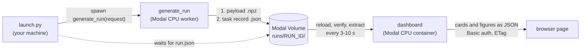

# PyMC Generator live dashboard

> **Experimental, internal tool.** `live_dashboard/` is a PyMC Labs repository tool, not
> part of the installed `pymc-generator` package, and its publication protocol is an
> interim single-writer design (see
> [Publication protocol](#publication-protocol-pymc-generator-live-publication-10)).

Follow a generation run while it happens. A generation worker publishes each completed
task (a corpus payload plus a versioned JSON completion record) into a store; a separate
web app polls the store, verifies and extracts every newly published output once, and
redraws its cards and figures in the browser. Generation never reruns for the UI.

On Modal, both live in the **`pfn` environment**: `generate_run` runs on a CPU container
and the dashboard on a separate CPU container with a stable URL behind HTTP Basic
authentication. The same code runs locally against a folder.

> **Decision (October 2026): workers run on CPU, not on an A100.** Generation is CPU
> work: PyTensor 3.2 has no native CUDA backend, and the generator compiles its graphs
> in `FAST_COMPILE` mode to Python/NumPy thunks. Measured on Modal, CPU-only workers
> generate as fast as A100 workers for about 1/20 of the cost; see
> [Hardware decision: CPU workers](#hardware-decision-cpu-workers).

## How it works



1. **A request names a run.** A request is a label, a preset, a number of worlds, the
   worlds per task and a seed. The run id is `<label>-<sha256(request)[:12]>`, so the
   same request always names the same run (that is how `--resume` finds it) and a new
   label starts a new run. The run is split into `worlds ÷ worlds_per_task` tasks, and
   task `i` generates with seed `seed + i`.
2. **Launch** (`launch.py`, an ephemeral Modal app run from your machine). It checks the
   request and the demo bounds, refuses an existing run unless `--resume`, spawns the
   deployed `generate_run`, prints the run id and its dashboard link, and for a new run
   waits until the run's manifest appears in the Volume.
3. **Generate and publish** (`generate_run` calling `run_generation` in
   `generation.py`, one container at a time). It writes the run manifest (effective
   configuration, digest of the generating source, package versions, git revision).
   Then, task by task:
   - `DataGenerator.generate(n_tasks=worlds_per_task, seed=seed + i)` generates the
     task's worlds (with the preset `cycle[i mod n]` of a [preset mix](#presets-and-mixes));
   - the corpus is saved as `.npz`, reloaded and validated;
   - it is written create-only and the Volume is committed;
   - only then is the task's JSON completion record written and committed.

   An attempt record tracks progress. The attempt stops starting tasks before Modal's
   kill time, so `--resume` can continue it.
4. **Store** (Modal Volume `pymc-generator-live-dashboard`). Plain files under
   `runs/<run_id>/`; nothing is ever overwritten. A retry writes under its own attempt
   id. The layout is under [Publication protocol](#publication-protocol-pymc-generator-live-publication-10).
5. **Read** (the `dashboard` container: `collection.py`, `extract.py`). A poller thread
   reloads the read-only Volume, every 3 s while a run is generating and every 10 s
   otherwise. On each poll it:
   - lists every task and decodes the records;
   - checks each new payload's size and SHA-256;
   - extracts each new payload's metrics once: composition shares, channel and
     control impact through the library's `outcome_distributions`, and the adstock and
     saturation families of each world's active channels.

   The result is an immutable snapshot; requests never touch the Volume.
6. **Show** (`figures.py`, `web.py`, `static/`). The page polls the JSON API with an
   ETag. The server answers 304 until the snapshot changes; then the page redraws the
   cards and Plotly figures. Every path requires Basic authentication.

Locally the same flow runs without Modal: `generate` writes into a folder and `serve`
reads it.

## What the page shows

| Element | Definition |
|---|---|
| Card: worlds generated | Consumable worlds (published, verified, extracted) of the run's target. |
| Card: generation speed | Consumable worlds per minute of active generation time (the union of task start–finish intervals, so gaps between attempts do not count). |
| Speed over time | Per-task rate (worlds ÷ generation time) and the cumulative average. |
| Worlds over time | Cumulative consumable worlds at each publication, with the target. |
| Channel impact | Two distributions: each active channel's direct contribution share of its world's outcome (pooled), and each world's total channel share (direct + indirect). |
| Control impact | The same for controls: each active control's direct contribution share (pooled), and each world's total control share (net, can be negative). |
| Baseline | Each world's baseline share. Channel impact, control impact and baseline share one 0–100 % axis (widened only to fit a value outside it), so the three compare at a glance. |
| Composition triangle | Each world's channel / control / baseline shares of its total outcome, at its exact barycentric position (corner = 100 %). Semi-transparent dots, so overlap shows density; worlds with a negative part sit outside and are drawn as ×. |
| Worlds per saturation form | Consumable worlds per saturation family their active channels use, with all six library families on the x axis (linear, Hill, logistic, Michaelis-Menten, tanh, root); a world whose channels mix families counts once in each. Read from each payload's `sat_family`, which the library records only for configurations with mechanism priors; worlds without it are noted, not counted. |
| Worlds per adstock form | The same for the adstock (carryover) family: none, geometric, Weibull (`carryover_family`, recorded in every payload). |
| Worlds per active channels × active controls | Heatmap of consumable worlds per combination of active-channel and active-control counts. Every combination the layout allows has a cell (1 to the slot count on each axis, 0 too when some world has none active); absent combinations stay blank, and the note counts how many are present. |
| Worlds per number of active inputs | Consumable worlds per number of active channels and per number of active controls, side by side: the matrix's two margins. |
| Status line | Run state, recorded tasks, zero-world tasks and shortfalls, rejected candidates, draw failures, unavailable/conflicting/invalid outputs, duplicates, and the newest attempt (with its GPU, for the early runs that had one). |

Shares use the trajectory-showcase notebook's definitions (`realized_shares`):
channel = Σ treatment contributions + Σ indirect effects, control = Σ covariate
contributions (net, can be negative), baseline = Σ intrinsic baseline + Σ latent
contributions + Σ observation noise, each divided by Σ outcome. Channel and control
impact are the library's `outcome_distributions(...)` `unit_share` of
`"treatment_contribution"` and `"covariate_contribution"`. Slots are activated as a
prefix (channel slot k is active only in worlds with at least k channels; controls
likewise), so impact is shown pooled, never per slot.

Only published worlds enter the distributions. Pending, zero-world, unavailable,
conflicting and invalid tasks appear in the status line instead.

## Local use

`live_dashboard` is a repository tool (it is not part of the installed `pymc-generator`
package): run its commands from the repository root.

```bash
uv sync --locked --extra dev --extra dashboard
# Credentials: a username and a PBKDF2 hash, written to a 0600 JSON file.
uv run --no-sync python -m live_dashboard hash-password --username demo \
    --output ~/.config/pymc-generator-dashboard/auth.json
# Terminal 1: the dashboard on http://127.0.0.1:8000
uv run --no-sync python -m live_dashboard serve --data-dir /tmp/live-runs \
    --credentials ~/.config/pymc-generator-dashboard/auth.json
# Terminal 2: generate 20 worlds as 10 published tasks of 2 worlds
uv run --no-sync python -m live_dashboard generate --data-dir /tmp/live-runs \
    --label local-demo --worlds 20 --worlds-per-task 2
```

Presets and mixes: see [Presets and mixes](#presets-and-mixes). `generate --max-seconds`
(default 3600) is the attempt's time limit; rerun the same command to resume a stopped
run.

## Modal deployment (environment `pfn`)

Run from the repository root with the Modal CLI (`modal` ≥ 1.5). Both entry points
refuse to run unless the CLI environment is `pfn`.

```bash
# 1. Credentials into a Modal Secret (JSON keeps the hash free of shell expansion).
uv run --no-sync python -m live_dashboard hash-password --username demo --output auth.json
modal secret create -e pfn pymc-generator-dashboard-auth --from-json auth.json
rm auth.json   # keep the password elsewhere; the secret holds only its hash
# 2. Deploy the worker and the dashboard (prints the stable dashboard URL).
modal deploy -e pfn live_dashboard/modal_app.py
# 3. Start a run: prints the run id and its dashboard link; for a new run it then waits
#    up to 10 minutes for the worker to publish it (or exits with the reason it refused
#    or failed). --resume continues an existing run without waiting; --wait blocks
#    until the worker returns its summary.
modal run -e pfn live_dashboard/launch.py --label demo --worlds 20 --worlds-per-task 2
```

Resources: app `pymc-generator-live-dashboard`, Volume `pymc-generator-live-dashboard`
(v1), Secret `pymc-generator-dashboard-auth`, web label `pymc-generator-dashboard`, and
the ephemeral launcher app `pymc-generator-live-dashboard-launch`, all in `pfn`. The
dashboard mounts the Volume read-only and calls `reload()` on it (verified on the first
deployment); if a future Modal release refused that, mounting it read-write keeps the
same behaviour because the dashboard never writes. Rotate credentials with
`modal secret create --force ...` and redeploy.

Limits: `generate_run` uses 2 CPU cores and 4 GiB (no GPU), one container at a time, a
1800 s timeout and one retry. So one launch costs at most about two attempts of 30
minutes, ≈ $0.13 at Modal's October 2026 list prices; a 20-world run costs about $0.003. A
run is capped at 400 worlds and 20 worlds per task. Requests the worker can never
satisfy (unknown preset, too large, a different generator than the stored run) are
refused without a retry; the refusal is recorded as a failed attempt when the run
exists. Each attempt records its kill time as `deadline_at` and stops starting tasks at
least max(90 s, twice its longest task) before it; a resumed run continues with the
unpublished tasks. The dashboard uses one CPU core and 2 GiB, one container, and scales
to zero after 10 idle minutes. Polling is every 3 s while a run is generating (or while
the store cannot be read) and every 10 s otherwise (`DASHBOARD_POLL_SECONDS`), plus up
to one browser poll; this is a refresh cadence, not a latency guarantee.

## Running future generations

### Choose the request

`launch.py` (Modal) and `python -m live_dashboard generate` (local) take the same
request options:

| Option | Default | Notes |
|---|---|---|
| `--label` | required | Part of the run id; use a new label for a fresh run. |
| `--preset` | `showcase-variety` | A preset from `PRESETS` or a mix from `MIXES` in `generation.py` (see below). |
| `--worlds` | 20 | Target worlds. Must be a multiple of `--worlds-per-task`, and at most 400 (`DEMO_MAX_WORLDS`). |
| `--worlds-per-task` | 2 | Worlds per published task, at most 20 (`DEMO_MAX_WORLDS_PER_TASK`). The page updates once per task, so smaller tasks show progress more often. |
| `--seed` | 29 | Base seed; task `i` uses `seed + i`. |

### Presets and mixes

| Name | Kind | Generates |
|---|---|---|
| `showcase-variety` | preset | The trajectory-showcase notebook's ranges: 10 channels, 10 controls, geometric adstock, Michaelis-Menten saturation, active counts drawn independently per world (the notebook's stratified design needs one call per multiple of 10 worlds). |
| `geometric-mm` | preset | [Two-style variety](#two-style-variety-geometric-mm-geometric-logistic) with Michaelis-Menten saturation. |
| `geometric-logistic` | preset | Two-style variety with logistic saturation. |
| `geometric-mm-logistic` | mix | `geometric-mm` and `geometric-logistic`, alternating by task. |
| `small` | preset | A tiny configuration for tests and smoke runs. |

A **mix** is one run whose tasks cycle through its member presets: task `i` uses member
`i mod n` (and, as always, seed `seed + i`). The members therefore grow together on the
page, finish with equal world counts when the task count is a multiple of `n`, and the
run's payloads are the concatenation of their generations: the page shows the combined
dataset, and the form panels show each member's worlds as they arrive. The manifest
records the cycle and every member's configuration (`generator.config = {"cycle": [...],
"presets": {...}}`), so changing any member refuses a resume. To add one, map a new name
to a tuple of preset names in `MIXES`.

### Launch, follow and resume

```bash
modal run -e pfn live_dashboard/launch.py --label <label> --worlds 100 --worlds-per-task 5
```

Open the printed link, or pick the run in the page's run menu.

- **Timing.** On Modal a world takes about 4–6.5 s of wall-clock time (generation plus
  about 2.7 s per task of Volume commits, which the speed card leaves out), so 20 worlds
  take 1.5–2.5 minutes. The two-style presets measured 5–15 % slower than
  `showcase-variety` per world (ten tasks of each on one laptop).
- **Attempt length.** One attempt lasts at most 30 minutes, roughly 260–420 worlds. A
  larger run stops cleanly; finish it by rerunning the same command with `--resume`.
- **Changed generator.** Resuming with a different configuration, code or environment
  is refused, so start a run with changed code under a new label.

| Run state | Meaning | Next step |
|---|---|---|
| `waiting` | The manifest exists but no attempt has recorded progress yet. | Wait. |
| `running` | The newest attempt is generating. | Wait. |
| `complete` | Every task has a final record. Zero-world tasks and output problems are listed in the status line. | Done. |
| `stopped` | The newest attempt ended (for example, near its time limit) with tasks left. | `--resume` |
| `failed` | The newest attempt raised. Its error is in `runs/<run_id>/attempts/`. | Fix the cause, then `--resume`. |
| `lost` | The newest attempt passed its kill time without finishing (the container died). | `--resume` |

### Get the data out

The trailing `/` downloads the run folder:

```bash
mkdir -p live-runs/runs
modal volume get -e pfn pymc-generator-live-dashboard runs/<run_id>/ live-runs/runs
```

Then, from the repository root (`live_dashboard` is not installed as a package):

```python
from pathlib import Path

from live_dashboard.collection import Collector
from live_dashboard.publication import payload_path
from live_dashboard.storage import DirectoryStore
from pymc_generator.data_generator import load_corpus

root = Path("live-runs")
collector = Collector(DirectoryStore(root))
collector.refresh()
run = collector.snapshot.run_index["<run_id>"]
corpora = [  # the verified payload of every published task
    load_corpus(root / payload_path(run.run_id, task.task_id, task.attempt_id))
    for task in run.tasks
    if task.status == "published"
]
# run.worlds, run.impacts and run.control_impacts hold what the share figures plot.
```

Reading through the dashboard's reader, rather than globbing `*.npz`, skips orphans of
retried attempts and payloads that fail their digest. To browse the downloaded runs
locally, run `serve --data-dir live-runs`. A mix run's payloads already hold every
member's worlds, so `corpora` is the concatenated dataset; a world's member is its task
index modulo the number of members, and its payload's `carryover_family` and
`sat_family` record its functional form.

### Two-style variety (`geometric-mm`, `geometric-logistic`)

Two configurations that differ only in the saturation curve, built to be generated
together (`geometric-mm-logistic`) as one dataset:

- **Inputs:** 10 channels and 10 controls; each world draws 1–10 active channels and
  1–10 active controls independently, so any of the 100 combinations can occur.
- **Graph:** every active channel and control points only to the target: no channel →
  channel, control → channel, control → control or latent arrows. (The library needs one
  latent node; it has no arrows and contributes exactly 0.)
- **Response:** geometric adstock (decay 0.05–0.9) with Michaelis-Menten saturation
  (half-saturation 0.1–10 × the channel's usual level, log-uniform) or logistic
  saturation (λ 0.3–5, uniform; the library has no log-uniform option for λ).
- **Positive effects:** channel contributions are non-negative by construction; controls
  have positive coefficients and stay positive because their level (4–7) sits well above
  their swings; the baseline walk is floored at 0; the library rejects any world whose
  target goes below 0.
- **Trajectories** (channels and controls alike): on/off blocks (half of the inputs),
  late starts and early stops (15 % each), trends, yearly seasonality, a level jump,
  weekly jitter and pulses, on random walks whose smoothness runs from raw to a 26-week
  moving average.
- **Baseline:** a random walk (level 2–20, spread ~ HalfNormal(0.8)) with its own
  smoothness, plus weekly noise (in target units: `outcome_std_mode="absolute"`).
- **Shares:** each channel contributes 0.1–10 target units at its usual level (up to
  100× apart within a world, so dominant and minor channels mix) and each control 1–3;
  the baseline level is 2–20. The channel, control and baseline shares follow the
  active counts and the baseline level.

Measured on the Modal run `two-styles-radical-5860b66184a8` (`geometric-mm-logistic`,
240 worlds, 2 per task, seed 1000), from its published payloads read on Modal through the
dashboard's verified reader:

| Property | Result |
|---|---|
| Worlds per style | 120 Michaelis-Menten, 120 logistic |
| (channels, controls) combinations | 91 of 100; every count 1–10 on both axes |
| Channel / control / baseline share (min–median–max) | 4.1–52–87 % / 0.5–21–71 % / 4.6–26–79 % |
| All three shares within 5–90 % | 89.6 % of worlds; none above 90 %; two worlds have a part below 1 % (controls 0.55 and 0.61 %, one active control each) |
| Each active channel's direct share (median / 95th pct / max) | 7.4 / 21.5 / 61 % (effects 0.2–6: 5.7 / 17 / 42 %; 1–3: 5.3 / 12 / 32 %) |
| Active channels above 10 % / 20 % of the outcome | 36 / 6.7 % (effects 0.2–6: 24 / 1.7 %) |
| Largest channel per world (median / 90th pct) | 17.6 / 27 % (effects 0.2–6: 13 / 20 %; 1–3: 9.5 / 14.5 %) |
| Each active control's direct share (median / 95th pct / max) | 3.3 / 9.6 / 32.5 % |
| Channels: no zeros / under half zeros / half or more | 37 / 37 / 27 % |
| Channels: trend up / down / flat | 41 / 39 / 20 % |
| Channels: very smooth / medium / rough | 30 / 23 / 47 % |
| Controls: no zeros / under half zeros / half or more | 35 / 36 / 29 % |
| Controls: trend up / down / flat (changes beyond ±10 %: 47 % up, 27 % down) | 18 / 7 / 74 % |
| Controls: very smooth / medium / rough | 48 / 33 / 19 % |
| Baseline: flat / smooth moving / jagged; drifting up / down | 41 / 45 / 14 %; 13 / 10 % |
| Negative channel or control values; lowest target | none; 3.4 |

Definitions: a trend is the fitted change in log level over the weeks the input is on
(up above +1/3, down below −1/3); roughness is the week-to-week change relative to the
series' spread (white noise 1; very smooth < 0.1, rough > 0.4); a flat baseline varies
by less than 3 % of its mean, a jagged one is a nearly unsmoothed walk.

**Limits.** The library has no setting that targets shares, so a component can fall
under 5 % (10.4 % of this run's worlds): controls in 21 worlds, all with 1–3 active
controls; channels in 2 worlds with one channel; the baseline in 2 worlds where 7–10
channels take 69–80 %. Each channel's reference effect is drawn uniformly, so those
differ by at most 100× within a world (realized channel totals differ more: a median of
12× and up to 241× here); a log-uniform draw over 0.05–20 (a library change) gave a 95th
percentile near 30 % in a rescaling test, with many more near-zero channels (median
2 %). The baseline is one smoothed random walk plus noise: isolated spikes and set
trends would need a library change. Control positivity is a margin, not a floor (no
negative value in 5,000+ sampled control series); a hard guarantee needs a covariate
floor in the library. Controls trend less than channels, because their down-trends are
capped to keep them positive.

### A new generator configuration

1. Add a function to `PRESETS` in `live_dashboard/generation.py`. It must return the
   library configuration for one task, with **one world per cell**: set
   `n_cells=worlds_per_task` and `draws_per_cell=1`, because the library's default of 20
   would give a task more worlds than its target.

   ```python
   def _my_study(worlds_per_task: int) -> SCMPrior:
       from pymc_generator import make_scm_prior

       return make_scm_prior(n_cells=worlds_per_task, draws_per_cell=1, ...)  # your knobs
   ```

   Register it as `{"my-study": _my_study, ...}`.
2. Redeploy with `modal deploy -e pfn live_dashboard/modal_app.py`, then launch with
   `--preset my-study`.

The manifest pins the effective configuration and a digest of the generating source.
Editing a preset, or the generator, later therefore makes `--resume` refuse runs started
before the change; start new runs under a new label. The dashboard needs no change: it
reads any corpus that passes validation.

### Larger runs

The limits live in `live_dashboard/deployment.py`:

- `DEMO_MAX_WORLDS` (400);
- `DEMO_MAX_WORLDS_PER_TASK` (20);
- `GENERATION_TIMEOUT_S` (1800 s per attempt).

Raising them raises the worst case of one launch, which is two attempts of the full
timeout. Redeploy after changing them. Volume v1 recommends at most about 50,000 files,
and each task adds two: its record and its payload.

### Hardware decision: CPU workers

**Decision (October 2026).** `generate_run` requests no GPU: 2 CPU cores and 4 GiB.

**Why.** The first deployment requested an A100. During a run, `nvidia-smi` read 0 %
GPU utilisation, 4 MiB of GPU memory in use and no GPU processes. PyTensor 3.2 has no
native CUDA backend; its JAX and PyTorch backends are neither used nor installed. To
check speed, 12 concurrent 20-world runs were measured on Modal. All used the same
image, code and request with 2 CPU cores and 4 GiB each; only the GPU differed.

| Worker | Mean worlds/min (6 runs) | Range | Cost per 20-world run |
|---|---|---|---|
| CPU-only | 15.6 | 13.6–20.5 | ≈ $0.003 |
| A100 | 14.9 | 11.3–17.4 | ≈ $0.06 |

The difference is within run-to-run noise (Welch p = 0.65). Speed follows the host's
single-thread CPU speed: it correlates at r = 0.88 with a pure-Python benchmark run in
the same containers.

**Consequences.**

- **Cost:** about 1/20 per run, and the worst case of one launch (two 30-minute
  attempts) drops from ≈ $2.3 to ≈ $0.13.
- **Scheduling:** no GPU capacity is needed.
- **Earlier runs:** the runs made before the switch keep their recorded A100 in the
  status line.

**Revisit** if a generator path that actually uses a GPU appears, such as a JAX-backed
PyTensor mode:

1. Add `gpu=...` to the `@app.function` of `generate_run` in `modal_app.py`.
2. Record the GPU in its `WorkerInfo` (`gpu_requested`, `gpu_name`).
3. Re-measure the same way: at least 6 runs per hardware, launched concurrently, with
   the same image, request and CPU/memory. Compare the dashboard's speed card.

**Running costs.** The dashboard container costs about $0.06 per hour while a page is
open, and scales to zero 10 minutes after the last request. To see spend per app and
resource (completed hours only), run
`modal billing report --for today -r h --show-resources`.

### Housekeeping

- **Delete a run:** `modal volume rm -e pfn pymc-generator-live-dashboard runs/<run_id> -r`.
  It leaves the page at the next refresh. Never delete a run that is generating.
- **Deploy code changes:** `modal deploy -e pfn live_dashboard/modal_app.py`. New
  launches use the new code.
- **Rotate credentials:** see [Modal deployment](#modal-deployment-environment-pfn).

## Publication protocol (`pymc-generator-live-publication` 1.0)

This is the demo's **single-writer** protocol: correctness relies on one writer per run
(`generate_run` runs one container at a time and processes tasks in order; launch runs
only through the deployed function). It is not the multi-writer publication and
arbitration mechanism still being decided in pymc-labs/pymc-generator#54, and the
reader rules below are written so such a writer can replace this one.

Identities derive from the request only: `run_id = <label>-<sha256(request)[:12]>`
over (label, preset, worlds, worlds per task, seed); task `i` generates with seed
`seed + i` (exactly batch `i` of `DataGenerator.iter_batches`, which is reproducible but
not the same worlds as one larger call); world ids are `<run_id>/<task_id>/w<row>`.

```
runs/<run_id>/run.json                              run manifest (create-only)
runs/<run_id>/tasks/<task_id>/<attempt_id>.json     task completion record (create-only)
runs/<run_id>/payloads/<task_id>/<attempt_id>.npz   corpus payload (create-only)
runs/<run_id>/attempts/<attempt_id>.json            provisional progress of one attempt
```

The manifest records the effective configuration, a digest of the generating source,
the numerical package versions and the git revision; resuming a run with a different
configuration, code or environment is refused, so a changed generator needs a new run.

**Writer.** Each task's payload is saved and verified (reloaded and validated) in a
temporary directory, then written create-only under its attempt's own path and
committed; only then is the task record written and committed. Every record is decoded
with the reader's decoder before it is written. A task that the library cannot fill
within its bounded rounds publishes a zero-world record with the full shortfall and no
payload; any other failure fails the attempt (recorded in its attempt record) and leaves
the task for a retry. Resuming reuses a task when a record exists whose payload verifies
(or that has no payload).

**Reader.** Every poll lists every task directory (no high-water cursor), so
out-of-order publications are never skipped. Records with the same scientific content
(accepted worlds and payload digest) are duplicates: the smallest attempt id is
authoritative. Different content for one task is a **conflict**: the task is excluded
and shown. A payload must match its recorded size and SHA-256; otherwise the task is
**unavailable** and never silently replaced (it becomes available again only if bytes
matching the original digest reappear). Unreadable JSON is treated as not yet
published; unsupported contract major versions are rejected, not guessed; unknown
fields are ignored. Files whose names start with `.` are staging files and are never
read. Extraction runs once per payload and extraction version.

Crash windows: until the task record is persisted, readers consume nothing of the task;
a payload persisted before then (by its own commit or by a Volume background commit) is
an orphan that readers never consume, and the retry writes its own. Once the record is
persisted, readers consume the task and a retry reuses it.

Known limits: an in-place modification of an already verified payload that keeps its
size is not detected until the dashboard restarts; Volume v1 recommends at most five
concurrent writers and about 50,000 files, far above this demo's scale.
